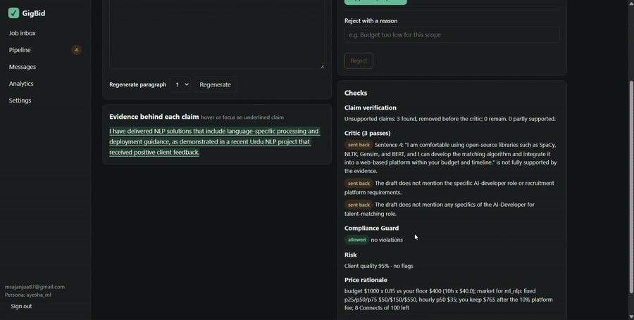
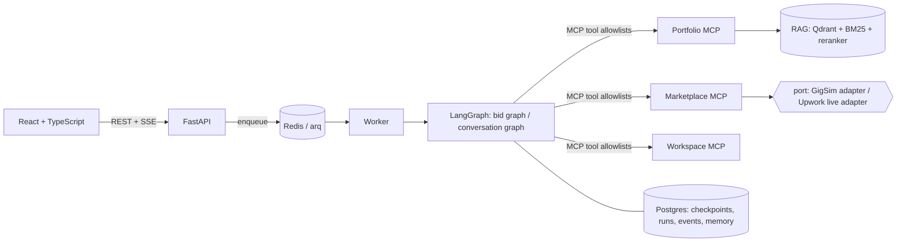

# GigBid

**An agent that finds freelance jobs, checks them for risk and fit, and drafts proposals where every claim links to your own portfolio. Nothing is sent until you approve it.**



> Live app: https://gigbid-yabd.onrender.com · Reviewer login: in the Classroom private comment · Demo video: [Google Drive](https://drive.google.com/file/d/1eZp1l22ywri_pNKwrZVusb6UNrgaq8Hv/view?usp=sharing) · Technical write-up: [Medium](https://medium.com/@msajanjua87/my-retrieval-never-said-no-how-every-job-looked-like-a-fit-d0a01e499181) ([source](docs/WRITEUP.md)) · Portfolio MCP server: [mcp_servers/portfolio/README.md](mcp_servers/portfolio/README.md)
> Demo GIF (21 s, above): approving a proposal, which then shows as submitted on the pipeline board · Public traces (LangSmith): [Critic loop, sent back twice](https://eu.smith.langchain.com/public/f111394b-46e0-489c-a5a3-14d93ac46b60/r) · [approved proposal after a crash and restart, submitted once](https://eu.smith.langchain.com/public/8cb4bb18-5471-41d1-a7ae-2a85de332e82/r) · skipped scam: `TODO` (the run is skipped with reasons free_work + off_platform, but its trace was dropped by LangSmith rate limits)

## What it does
1. A scheduled worker pulls new jobs from a marketplace (the GigSim simulator, or the official Upwork MCP server in live mode) and queues them.
2. For each job, three agents run **in parallel**: Job Analyst (structured `JobSpec`), Risk Assessor (scams, free-work and off-platform asks, injected instructions), Fit Matcher (each requirement mapped to portfolio evidence).
3. A decision node says skip / watch / bid. For bids: price (from real market data and your floor) -> draft -> **claim verification** (unsupported claims removed) -> Critic (max two send-backs) -> Compliance Guard (policy pack).
4. You see the draft with evidence on hover, the risk report, the price rationale and a dry-run preview of what would be sent and what it costs. You **approve, edit (diffed, re-checked, saved for style memory) or reject with a reason**. Only then is a *draft* created on the marketplace.
5. Client replies go through a second graph: classify intent, draft a reply or interview slots, approve, send.

## Architecture

Bid graph: `scout -> [analyst | risk | matcher] (Send, parallel) -> decide -> pricing -> writer -> verifier -> critic <-> writer (<=2) -> compliance -> approval (interrupt) -> execute`. Both graphs are rendered from code in `docs/images/*.mmd`. Details and the reason each agent exists: [docs/ARCHITECTURE.md](docs/ARCHITECTURE.md). Tools, annotations and trust rationale: [docs/TOOLS.md](docs/TOOLS.md).

## Results
All numbers come from committed files in `evals/results/` (`make eval`, tables regenerated by `python -m evals.runners.results_table` into [RESULTS.md](evals/results/RESULTS.md)). Open-weight models only (Groq: `gpt-oss-20b` small nodes, `gpt-oss-120b` Writer/Critic).

**Read these first:** the dev set is 14 compact jobs (from 42; the 30-job retrieval set is separate), one run each. The fit thresholds and the evidence floor were tuned on those same 14 jobs, so the decision numbers are optimistic: on the **two low-fit dev jobs the compact set left out, GigBid wrongly bids on both** [results: decision_eval_open_extra_lowfit.json], and the retrieval score separates fits from non-fits by only 0.86 logits [results: score_gap.json]. **GigSim client behaviour is a synthetic model I wrote**, so "reply rate" measures agreement with that model, not real clients. The course's GigSim, personas and policy pack were not provided; local mocks are used and disclosed in [DATA_CARD](docs/DATA_CARD.md).

**Decisions, proposals, cost** [results: decision_eval_open.json] (14 jobs)

| Metric | Value |
|---|---|
| bid/skip accuracy (F1 bid / skip) | 1.00 (1.00 / 1.00) |
| scam + injection precision / recall | 1.00 / 1.00 |
| price inside fair band | 1.00 |
| unsupported claims per proposal, before -> after verification | 0.33 -> 0 |
| p50 / p95 latency per job | 14.2 s / 27.6 s (budget 60 s) |
| USD per job / per proposal | 0.0004 / 0.0008 (budget 0.02 / 0.10) |
| simulated reply / hire rate | 0.33 / 0.17 |

**Retrieval variants** [results: rag_eval_all.json] (30 jobs, all three personas in one index)

| Variant | Recall@5 | nDCG@10 | retrieval p95 (s) |
|---|---|---|---|
| V0 naive dense | 0.933 | 0.885 | 0.99 |
| V1 requirement decomposition | 0.700 | 0.611 | 7.5 |
| V2 hybrid BM25+dense (RRF) | 0.933 | 0.884 | 0.67 |
| **V3 cross-encoder rerank (shipped)** | 0.950 | **0.912** | 1.8 |
| V4 outcome-aware | 0.933 | 0.890 | 1.7 |
| V5 decompose + hybrid + rerank | 0.967 | 0.858 | 24.7 |
| V8 corrective RAG (LangGraph loop) | 0.933 | 0.907 | 89 |

Per-persona-index numbers: [results: rag_eval_persona.json]. Full B5 table with pipeline columns: [RESULTS.md](evals/results/RESULTS.md).

**Ablation** [results: ablation.json] (nDCG@10 drop when a component is removed from decompose+hybrid+rerank): reranker **-0.204**, hybrid fusion **0.000**, decomposition **+0.058** (removing it *helps*).

**Single agent vs prebuilt supervisor vs my graph** [results: agent_comparison.json] (14 jobs)

| | Single ReAct | `langgraph-supervisor` | My graph |
|---|---|---|---|
| bid/skip accuracy | 1.00 | 0.64 | 1.00 |
| unsupported claims / proposal* | 0 | 5 (one proposal) | 0 |
| tokens / job | 1,379 | 741 | 2,172 |
| p95 latency | 186 s | 29 s | 28 s |

*Baselines are raw model output, graph drafts are post-verification, so this row favours the graph by construction. The single agent **ties** the graph on accuracy and uses fewer tokens; the graph is ~7x faster at p95 because the three analysis branches run in parallel, and it is the only one with the approval gate, compliance guard and verified claims.

**Tool granularity** [results: tool_granularity.json] (40 tasks): 16 tools with rewritten descriptions 100% tool / 100% argument accuracy vs 24 fine-grained tools 70% / 70% vs 4 coarse tools 85% / 67.5%.

**Injection defence** [results: injection_eval.json] (6 planted posts): attack success 0.67 -> 0.0 after defences; the planted word reached a draft in 50% of cases before and 0% after.

**X2 proposal experiment** [results: ab_experiment.json]: deliverable-first vs intro-first openings, +0.065 simulated reply probability (permutation p = 0.0033, 30 jobs), but only 16 vs 17 sampled replies. See [docs/EXTENSION.md](docs/EXTENSION.md).

**Judge calibration:** the LLM judge is **not usable**: on 30 blind items my labels and the judge agree at weighted Cohen's kappa 0.001 (exact agreement 0.10; mean human 3.07 vs mean judge 4.97, the judge gives almost everything a 5) [results: judge_calibration.json]. So no judge scores are reported as quality evidence.

**Failure analysis:** [docs/FAILURES.md](docs/FAILURES.md) (14 failures, fixes, and which fixes worked).

## Run it
```bash
cp .env.example .env            # GROQ_API_KEY (or GROQ_API_KEYS=k1,k2,...), TOKEN_ENC_KEY, REVIEWER_EMAIL / REVIEWER_PASSWORD
make dev                        # docker compose: web+API, worker, 3 MCP servers, Postgres, Redis, Qdrant (+ Ollama with --profile local-llm)
# without Docker:  python -m scripts.localenv uvicorn apps.api.main:app   and   cd apps/web && npm run dev
make test | make eval | make smoke-eval | make lint
```
Ops notes, degraded mode, schedules and the change-request procedure: [docs/RUNBOOK.md](docs/RUNBOOK.md). Switching GigSim -> live Upwork is `MARKETPLACE_ADAPTER=upwork` plus the per-user OAuth connection (the live adapter is written to the Upwork MCP server's tool names but has **not been run against a real account**).

## Versions (pinned in `pyproject.toml`, tested on Python 3.14.6)
langgraph 1.2.20 · langgraph-checkpoint-postgres 3.2.0 · langgraph-supervisor 0.0.31 · langchain-mcp-adapters 0.3.2 · mcp 1.30.0 · fastapi 0.162.3 · pydantic 2.13.4 · arq 0.28.0 · qdrant-client 1.20.0 · fastembed 0.9.1 (embeddings `BAAI/bge-small-en-v1.5`, reranker `Xenova/ms-marco-MiniLM-L-6-v2`) · langsmith 0.14.17 · React 18.3.1 · Vite 5.4.10 · Playwright 1.48.2. Dev-size embedding and reranker models are used on this CPU-only machine; `bge-m3` / `bge-reranker-v2-m3` are the intended GPU-host swap (config only).

## Data
Real: 120 Upwork job postings and client signals, plus market percentiles from 1.3M contracts, from public Kaggle datasets (credit and licences in [DATA_CARD](docs/DATA_CARD.md)). Synthetic: personas, labelled dev set, planted scams and injections, client replies and all GigSim outcomes.

## Safety
Job posts and client messages are untrusted data: delimited, tag-neutralised, injected sentences scrubbed before drafting, a deterministic detector OR-ed with the LLM's flag; emails, phones and card numbers masked in logs; OAuth tokens encrypted (Fernet) and never returned or logged; every query tenant-scoped; no scraping or browser automation. What still gets through (paraphrased or non-English injections) is in [docs/FAILURES.md](docs/FAILURES.md).
